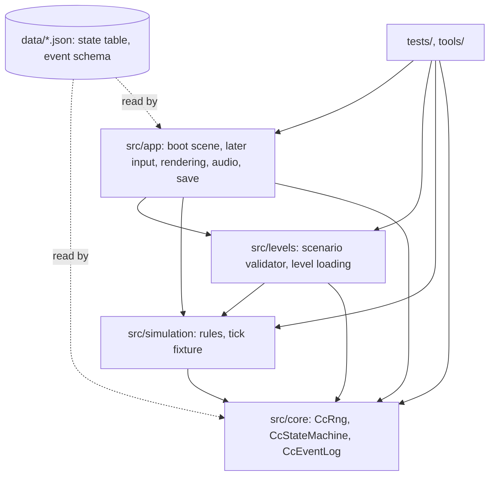

# ARCHITECTURE (Stage 07)

Proposed for approval. Every box is a directory under `src/`; arrows mean "may depend on". `scripts/lint.py` rule L4 fails the build on an arrow pointing the wrong way, and L8 keeps `core` and `simulation` off the scene tree.



```
app  ->  levels  ->  simulation  ->  core
 |________|____________|____________^      (app may use any lower layer; nothing uses a higher one)
tests/ and tools/ may use any layer
```

## Boundaries

| Rule | Why | Enforced by |
|---|---|---|
| No `[autoload]` in `project.godot` | no surprise global manager or singleton. Every service is created by its owner and passed in | lint L2 |
| `core` and `simulation` never use `Node`, `Input`, `Time`, `OS` or `get_tree` | the rules must run headless and replay exactly | lint L8 |
| All randomness goes through `CcRng` named streams | same seed gives same run on any platform | lint L5; golden test T-RNG-1 |
| Events must be in `data/events.schema.json` with all required fields | every visible claim traces to a logged event (spec A4) | `CcEventLog`; lint L7 keeps the schema equal to `docs/SIMULATION_EVENTS.md` |
| State changes only through a data table | invalid and duplicate transitions are caught, not coded around | `CcStateMachine`; lint L6 on the table |
| Class names start with `Cc` | avoid clashes with engine classes | lint L3 |
| Rendering reads the simulation and never writes to it | (Stage 10) | review; not yet testable |

Modules named in `docs/ENGINE_DECISION.md` that do **not** exist yet: `replay`, `camera`, `input`, `rendering`, `audio`, `save`. They get a directory when their stage arrives. Nothing is created empty.

## What Stage 07 contains

| Piece | File | Note |
|---|---|---|
| Stable random service | `src/core/rng_service.gd` | xorshift32, integer-only, named streams |
| State machine | `src/core/state_machine.gd`, `data/boot_states.json` | BOOT, READY, RUNNING, PAUSED, ENDED |
| Event log and schema | `src/core/event_log.gd`, `data/events.schema.json` | FNV-1a 32 hash of the canonical text |
| Tick fixture | `src/simulation/tick_fixture.gd` | 640 ticks, seeded; **not** the game rules |
| Scenario validator | `src/levels/scenario_validator.gd`, `scripts/validate_scenarios.py` | two implementations that must agree on the fixtures |
| Headless runners | `tools/test_runner.gd`, `tools/scenario_runner.gd` | **not run here** |
| Boot screen | `src/app/boot.tscn`, `boot.gd` | blank, shows the state name, prints `BOOT_STATE=READY` |
| Input map | `project.godot` | `pause` P, `rotate_sign` R, `retry` E (placeholders for desktop testing; touch comes in Stage 09) |
| Lint and its self-test | `scripts/lint.py`, `scripts/test_lint.py` | rules L1 to L9 |
| CI | `.github/workflows/ci.yml` | UNVERIFIED, never executed |

The Python reference model `scripts/ref_model.py` generates the golden values. It is not the game; the Stage 06 spike (`spikes/godot-sim`, never run) stays the place for the full simulation until Stage 08.

## Known weaknesses

- Two validators (GDScript and Python) can drift. They are tied together only by the shared fixtures.
- `CcEventLog` accepts only int and string field values, so cost breakdowns with decimals (`DECISION.cost_by_edge`) need fixed-point integers or strings. Decide at Stage 08.
- The `app` layer will grow. If input, rendering and audio need their own boundaries, split it at Stage 09 or 10 with approval.
